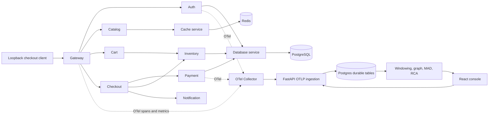

# Architecture

CausalTrace is a modular FastAPI monolith. The separate demo services exist to create actual distributed behavior, not to artificially fragment the analysis system.

**Data ownership.** Primary tables: `spans`, `metrics`, `events`, `dependency_edges`, `deployments`, `incidents`, `timeline`, `experiments`, `audit`, `benchmarks`. SQLAlchemy ORM and a versioned Alembic migration establish schema. Primary event/span uniqueness is enforced by database constraints, with SQLite/PostgreSQL atomic conflict-ignoring ingestion.

**Topology.** On a trace, if a span's parent is from a different service, create a caller → callee edge with span timing, observed error flag, provenance `span-parent`. Missing parent spans are kept as trace orphans; edges can become visible if their parents arrive later. Results are bounded to 50,000 most recent edges for interactive requests.

**Critical path.** The trace explorer shows both observed min(start)/max(end) wall-clock difference and an upper-bound root-to-leaf sum of span durations. Overlapping activity or cross-host clock skew can invalidate the summed path as true latency; the UI does not portray it as ground truth.

**Queueing.** The Collector has a `memory_limiter`, batch processor, bounded sending queue, and bounded retries. The backend limits request body size, span count and simultaneous OTLP requests. Without a durable broker, this is **best-effort delivery**, not guaranteed replay across all failures. The experiment executor has exactly two thread workers and two concurrent slots; fault TTLs bound each experiment independently.

**Deployment.** Docker Compose uses an `internal` backend for Postgres/Redis, a telemetry network for API/Collector/web/lab nodes, and loopback-only published ports. No Kubernetes or Kafka is required for this target workload.
