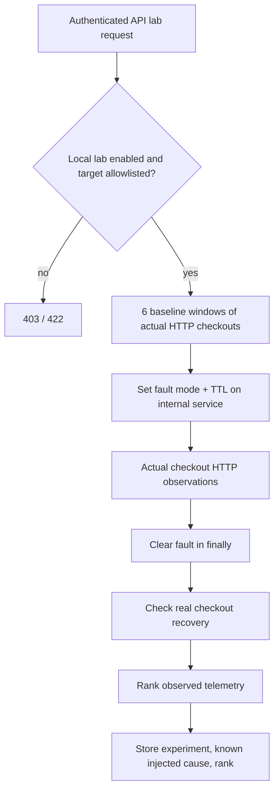

# Safe local fault-injection laboratory

The lab is explicitly enabled by `CAUSALTRACE_LAB=isolated-compose-only` and listens only through Compose DNS; only gateway, API and web are published to loopback. Fault-setting endpoints are authenticated and accept only a fixed service allowlist; there is **no free-form URL, host, IP or shell command** in user input.

Supported fault modes:

| Mode | Action on the selected real HTTP service |
|---|---|
| `error` | Server returns HTTP 503 within a traced request |
| `unavailable` | Service rejects requests with 503; process itself remains up |
| `latency` | Bounded 0–1.2s delay |
| `timeout` | 2.5s bounded delay, exceeding 2s downstream timeout |
| `db_exhaustion` | Database-role client pool is restricted to two simultaneous real PostgreSQL connections; two held SQL sessions create pool exhaustion. Not a server-wide PostgreSQL `max_connections` failure |
| `cache_failure` | Cache service deliberately fails, causing real downstream checkout failures; Redis server remains running |
| `saturation` | CPU-busy loop capped at ~200ms per request, no unbounded load |
| `config` | Controlled configuration-related 503 response (not a real config deployment) |

Fault changes carry `duration_seconds ∈ [1,120]`, probability, deterministic seed, and bounded delay; the service checks TTL *on each request*. Fault cleanup explicitly sets `mode=none` in a `finally` block; the service TTL independently protects against worker death. The API uses at most two concurrent experiment workers. It executes 6 groups of baseline checkout requests separated by 5 seconds, injects the fault, samples up to 120 requests during the configured duration, clears fault, collects recovery samples, waits 3 seconds for telemetry export, computes observational ranking and stores a ground-truth rank.

**Run:** `python scripts/run_lab.py` (three cases: payment error, cache latency, database client-pool exhaustion). The results are persisted in PostgreSQL and displayed in the Lab tab. This script was not verified against a running Docker Compose stack in the provided execution environment; refer to the validation report before treating it as passing acceptance.

## Experiment isolation and cancellation behavior (latest implementation)

The controller admits only one experiment at a time. Baseline spans, fault
spans, and recovery samples are separated using **actual recorded timestamps**;
ranking input is bounded to the current experiment rather than the accumulated
database. Ground-truth `target` and `mode` fields are used only *after* inference
for computing its rank. Incoming evidence can be missing or delayed, so a run
with no persisted spans, no cross-service edges, no observed fault effect, or
failed recovery is a **failed** experiment, not a pass. Intervention supports
attribution inside the deliberately manipulated lab, not arbitrary causal
identification on an external production system.

`POST /api/lab/experiments/{id}/stop` marks the job stopping; the worker
checks that state between samples. Explicit cleanup always attempts to clear
the allowlisted service fault; each fault has a maximum 120-second TTL as a
second safety boundary. A cleanup command failure changes the recorded status
to failed. The independent host acceptance command `python scripts/verify_live.py`
checks three fault categories and refuses to pass if cleanup/recovery evidence
is missing.
